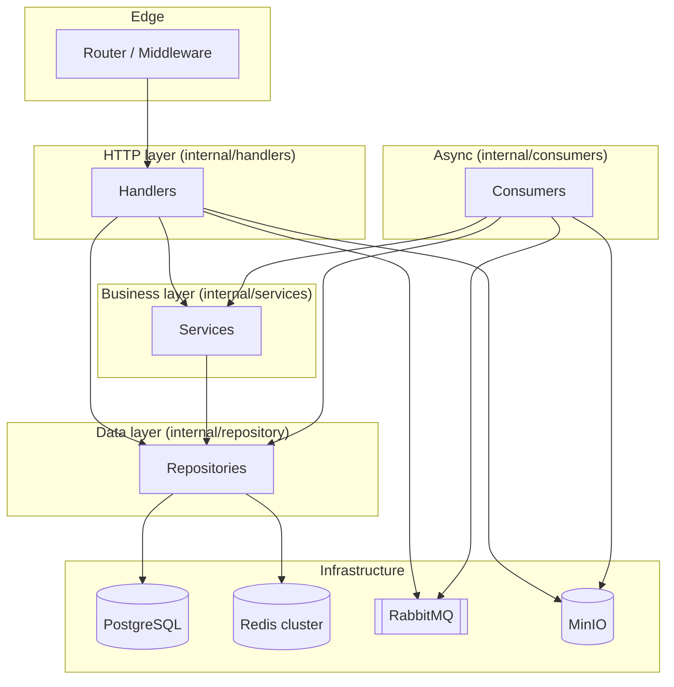
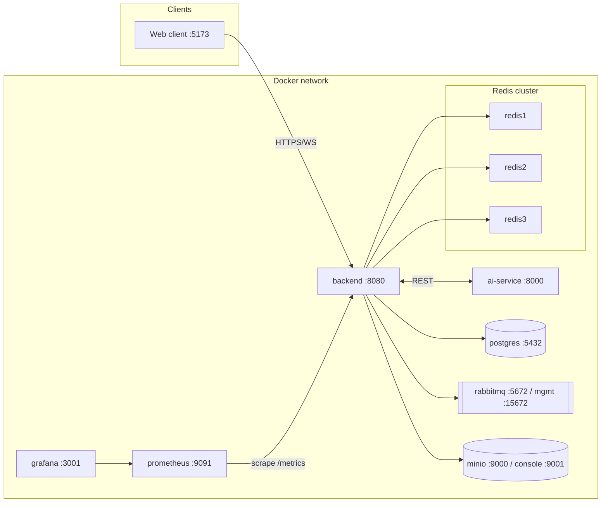
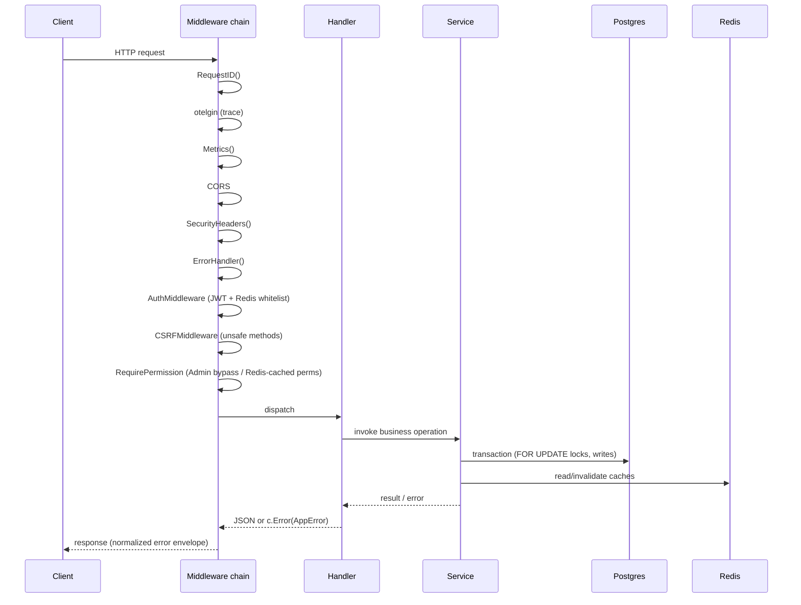

# Architecture

This document describes how the Quantify backend is structured, the decisions
that shaped it, and how it is deployed. For business rules see
[business_logic.md](./business_logic.md); for operations see
[runbook.md](./runbook.md).

The backend is a Go (1.25) monolith built on Gin, backed by PostgreSQL, a Redis
cluster, RabbitMQ, and MinIO object storage. A separate Python `ai-service`
provides forecasting and churn prediction.

---

## 1. Layered overview

The code follows a strict **Handler → Service → Repository** layering. Handlers
decode HTTP, services hold business logic and transactions, repositories own
SQL/GORM access.



Key packages under `backend/internal/`:

| Package | Responsibility |
| :--- | :--- |
| `config` | koanf-based config loading (defaults → TOML → env), validation. |
| `bootstrap` | Wires the dependency graph, starts server/consumers/cron, graceful shutdown. |
| `app` | The typed `Container` holding all repos/services/handlers/clients. |
| `router` | Route table + middleware chain. |
| `middleware` | Auth, CSRF, permission, security headers, metrics, request ID, error handler. |
| `handlers` | HTTP handlers (thin). |
| `services` | Business logic and DB transactions. |
| `repository` | GORM data access + Redis caching. |
| `consumers` | RabbitMQ consumers (bulk, alert, reporting). |
| `message_broker` | RabbitMQ connection + topology constants. |
| `domain` | GORM models. |
| `websocket` | Real-time notification hub. |
| `storage` | MinIO uploader abstraction. |
| `integrations` | Webhook registry (Shopify, QuickBooks stubs). |
| `telemetry` / `metrics` | OpenTelemetry tracing + Prometheus metrics. |

---

## 2. Dependency injection container

`internal/app/container.go` defines a single `Container` struct that holds the
entire wired graph: infrastructure clients (`DB`, `Redis`, `AMQP`, `Hub`,
`Uploader`), every repository, every service, and every handler.

`bootstrap.NewApp` (`internal/bootstrap/app.go`) builds the container **once**,
then hands it to `router.SetupRouter(c)`. This replaced ad-hoc package-level
globals and inline construction inside the router, so tests can inject fakes and
the wiring is explicit and inspectable in one place.

### Bootstrap sequence

1. Init OpenTelemetry tracer (only if `OTLP_ENDPOINT` is set).
2. `repository.InitDB` → GORM connection. Optionally populate the search index
   when `RUN_MIGRATIONS=true`.
3. Seed roles and the AI agent user (idempotent).
4. Init Redis, RabbitMQ, JWT secrets, WebSocket hub, MinIO uploader.
5. Construct repositories → services → handlers into the `Container`.
6. Register webhook integrations (Shopify, QuickBooks).
7. Build the cron scheduler and the Gin router; create the `http.Server`.

`App.Run` starts cron, the HTTP server, and the consumers, then blocks on the
context. `App.Stop` performs graceful shutdown: cancel consumer subscriptions
first (so AMQP loops exit before the broker connection closes), shut down the
HTTP server with a 10s timeout, stop cron, flush the tracer, and close DB /
Redis / AMQP.

### Background workers

| Worker | Trigger | Purpose |
| :--- | :--- | :--- |
| Bulk consumer | RabbitMQ `bulk.import` / `bulk.import.confirm` / `bulk.export` | CSV import validation/finalize, export. Runs `CONSUMER_CONCURRENCY` workers. |
| Alert consumer | RabbitMQ `alert.triggered` | Fan out alerts to subscribed users (respecting per-user opt-outs). |
| Reporting consumer | RabbitMQ `report.generate` | Generate report jobs asynchronously. |
| Cron `@every 5m` | Scheduler | `CheckAndTriggerAlerts` (low stock, expiry, etc.). |
| Cron `@daily` | Scheduler | `GenerateDailySalesSummary`. |

---

## 3. Architecture Decision Records (ADRs)

### ADR-1: Router consumes a DI container (P4.T1, P4.T2)

**Context.** The router previously constructed repositories, services, and
handlers inline and relied on package-level DB globals, making the wiring hard
to test and reason about.

**Decision.** Introduce `app.Container`, build it once in bootstrap, and pass it
to `SetupRouter(c *app.Container)`. Every route reads its handler from the
container.

**Consequences.** Wiring is explicit and centralized; handlers are injectable in
tests. The route table is still a single large function — extracting per-domain
group files under `internal/router/groups/` is a planned follow-up and has not
landed yet.

### ADR-2: golang-migrate for schema changes (P4.T5, P4.T7)

**Context.** GORM `AutoMigrate` ran on every boot, which is unsafe in
production (no down migrations, no version tracking, risk of drift).

**Decision.** Adopt `golang-migrate` with versioned SQL files under
`backend/migrations/`. A dedicated `cmd/migrator` CLI applies them:

```bash
go run ./cmd/migrator -cmd up      -dsn "$DATABASE_URL"
go run ./cmd/migrator -cmd down    -dsn "$DATABASE_URL"
go run ./cmd/migrator -cmd version -dsn "$DATABASE_URL"
```

`AutoMigrate` is now **gated by `APP_ENV=dev`**; production/staging boot logs
"AutoMigrate skipped; run cmd/migrator to apply migrations" and does not touch
the schema. Seed data (roles, permissions, settings) lives in
`0002_seed.up.sql`.

**Consequences.** Schema changes are reviewable, reversible, and versioned.
Operators must run the migrator as part of deployment (see
[runbook.md](./runbook.md)).

### ADR-3: koanf-based configuration (P4.T13)

**Context.** Config came from scattered `os.Getenv` calls with implicit
defaults and no validation.

**Decision.** Load config with koanf in precedence order: **built-in defaults →
optional TOML file → environment variables** (`internal/config/config.go`).
`LoadConfig` validates critical config and **fails fast** if a required secret
is missing or set to a known default value.

**Consequences.** All settings are typed and documented in one struct; bad
config is caught at boot rather than at runtime. See
[security.md](./security.md) for the secret-validation list.

### ADR-4: Confirmation-gated bulk import (P3.T1, P3.T2)

**Context.** The import consumer used to create products immediately on
validation, with no review step and no idempotency.

**Decision.** Split import into validate (`→ PENDING_CONFIRMATION`) and confirm
(`→ COMPLETED`) stages, with the confirm endpoint as the only product-creation
path. Confirm is idempotent and uses `ON CONFLICT DO NOTHING`.

**Consequences.** Operators preview validation results and new entities before
committing; re-runs are safe. See [business_logic.md §4](./business_logic.md).

---

## 4. Deployment topology

The reference deployment is Docker Compose (`docker-compose.yml`). The Redis
cluster is initialized by a one-shot `redis-init` job; the backend waits on
healthy Postgres, RabbitMQ, and a completed Redis init.



| Service | Image / build | Notes |
| :--- | :--- | :--- |
| backend | `./backend` | Go API + consumers + cron. Resource-limited (0.5 CPU / 512M). |
| ai-service | `./ai-service` | Python (Poetry). Talks to backend via `BACKEND_URL`; authenticates as the AI agent user. |
| db | `postgres:15-alpine` | Healthchecked with `pg_isready`. |
| redis1/2/3 | `redis:7.0` | Cluster mode, `redis-init` creates the cluster with 0 replicas. |
| rabbitmq | `rabbitmq:3-management-alpine` | AMQP + management UI. |
| minio | `minio/minio` | Object storage for imports/exports/report files. |
| prometheus / grafana | official images | Metrics + dashboards (provisioned from `grafana/`). |

Observability: the backend exposes `/metrics` (Prometheus) and, when
`OTLP_ENDPOINT` is set, exports OTel traces. `/health` and `/ready` are
liveness/readiness probes; `/ready` checks DB, Redis, AMQP, and MinIO.

---

## 5. Request lifecycle

A typical authenticated, permission-guarded request flows through the middleware
chain defined in `router.SetupRouter`:



Notes:

- **Public routes** (`/health`, `/ready`, `/metrics`, `/ws`, `/swagger`,
  `/payment/*`, `/webhooks/*`, `POST /users/register`, `POST /users/login`)
  skip auth.
- **Auth** validates the JWT signature *and* confirms the token's JTI is present
  in the Redis whitelist (`access_token:<jti>`), so revoked/logged-out tokens
  are rejected.
- **CSRF** is enforced only on `POST/PUT/PATCH/DELETE` and validates a
  per-user `X-CSRF-Token`.
- **Errors** are funneled through `c.Error(appErrors.NewAppError(...))` and
  rendered by `ErrorHandler` into a consistent envelope; handlers do not write
  ad-hoc error JSON.
- **Real-time**: state-changing operations broadcast over the WebSocket hub to
  clients subscribed by permission (e.g. `returns.manage`, `pos.view`).

---

## 6. Related documents

- [business_logic.md](./business_logic.md)
- [security.md](./security.md)
- [runbook.md](./runbook.md)
- Backend changelog: `backend/CHANGELOG.md`
